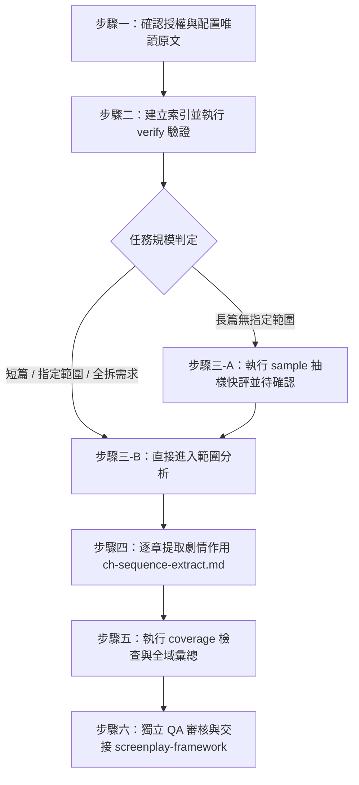

# 原著分析與改編前置規範 (screenplay-source-analysis)

本操作規範定義原著文字分析、章節索引建構、行號驗證、劇情作用逐章提取與下游改編交接之標準工作流程。所有結論都應提供可回查的分析依據，改編決策權保留給創作者。

## 1. 核心原則與界線聲明

1. **原著唯讀與版權合法性**：
   - 來源檔案之合法改編與使用權限一律由創作者確認。
   - `輸入/` 目錄內之原始文本為絕對唯讀，嚴禁任何覆寫、格式清洗或內容修改。嚴禁整段抄錄原文，僅可擷取必要之最短詞句作證據錨定。
2. **客觀證據錨定**：
   - 任何事實性分析結論，均必須標記來源章序與精確起訖行號（例如：`來源：第 12 章，原文第 138–151 行`）。原文未明確交代之處，必須明確標示「未明確」，嚴禁推測填空或腦補設定。
3. **提案性質與權責分工**：
   - 本技能產出之角色演進、世界觀設定、改編取捨、爽點排序與分集切法**均為「候選提案（Candidate）」**，非正式設定，亦非正式劇本大綱。
   - 所有候選提案必須交由創作者裁決。未獲得下游明確指令前，本技能嚴禁代替下游建立正式大綱或人物資產卡。
4. **下游交接鏈條**：
   - 分析完成後，將核對無誤之事實依據、候選清單及未決問題交付 `screenplay-framework` 確立方向與正式設定，再由 `screenplay-director` 拍板改編階段。下游創作階段一律遵循 `antigravity-writer` 規範。
5. **獨立 QA 誠實狀態**：
   - 流程結束時必須完整保留獨立 QA 狀態（待審／通過／退回）與檢核範圍。未經獨立審核確認證據者，一律標示為「待審」，嚴禁假稱通過。
6. **上游改編聲明與技術邊界**：
   - 本技能工作流根據公開上游 MIT 專案 `short-drama-novel-analyze`（commit `37232f6d22e174c36e321d2e3a1a3ae871e7d602`）之章節索引工作流程改編。
   - **嚴格宣告**：內建模組僅提供章節切分、行號定位與覆蓋率盤點等結構性工具，絕不宣稱能自動抽取劇情、判定證據真偽、執行實質 QA 或確定改編方案。

---

## 2. 工具清單與 CLI 命令規範

技能內建 CLI 工具位於 `scripts/novel_index.py`，基於 Python 3.9+ 標準庫實作，無外部依賴。

### 支援之標題正則規則
支援阿拉伯數字與中文數字（包含「兩」及「節」），能自動辨識下列章節標籤：
`章`、`回`、`集`、`話`、`幕`、`節`。
索引產出之章節範圍包含關鍵欄位：`line_start`（起始行）、`line_end`（結束行）。

### 指令集規格

1. **建立索引**
   掃描原始文本並建立章節結構索引 JSON。
   ```bash
   python scripts/novel_index.py index <SOURCE_FILE> --out <INDEX_FILE>
   ```
2. **驗證索引**
   比對現有索引與來源文字檔案之雜湊值與行數。索引（包括手工章界索引）必須帶有來源 SHA-256；原文若有任何變動或索引缺少有效雜湊，將回傳非零代碼並阻擋後續作業。
   ```bash
   python scripts/novel_index.py verify <INDEX_FILE> <SOURCE_FILE>
   ```
3. **抽樣選章**
   依指定數量均勻抽取具代表性之章節，用於長篇初步快評。
   ```bash
   python scripts/novel_index.py sample <INDEX_FILE> --count <N>
   ```
4. **檢查進度與覆蓋率**
   比對分析目錄中之逐章分析檔與索引章節範圍，檢查章檔存在性、命名與 sequence 連續性。
   ```bash
   python scripts/novel_index.py coverage <INDEX_FILE> <ANALYSIS_DIR> --require-source-hash [--start <N>] [--end <N>]
   ```
   每份章分析檔第一行須有 `<!-- source_sha256: <64 位小寫十六進位雜湊> -->`，內容必須與索引 `source.sha256` 相符。strict 模式也要求索引含有效 SHA-256；把缺少標記或索引雜湊的章檔列入 `unverified_files`，把雜湊不符的章檔列入 `stale_files`，並阻止 `complete`。
   > **注意**：`coverage --require-source-hash` 檢查檔案存在、命名、範圍及標記所載來源版本；它**不會**驗證分析檔內容或證據真偽，也無法證明標記後的分析確實重新完成。

---

## 3. 分析標準作業程序 (SOP)



### 步驟一：版權合規確認與原文配置
1. 由創作者確認原著使用權限合法性。
2. 將原著檔案以唯讀權限放入 `輸入/` 目錄（或指定輸入路徑），不得異動其文字或編碼。

### 步驟二：章節索引建構與驗證
1. 執行 `index` 命令產出索引檔。
2. 立即執行 `verify` 命令驗證一致性。
3. **章界唯一性**：後續所有章級進度、起訖行回查與分集切法，一律僅以該份驗證通過之索引為準。若原文異動導致 `verify` 失敗，必須重新建立索引並清空不相容快取。

### 步驟三：抽樣快評 vs 範圍拆解決策分流
- **長篇且未指定範圍**：
  1. 執行 `sample` 抽取樣本章節（如 5–10 章）。
  2. 撰寫抽樣快評報告，必須具體註明：總章數、抽樣章數、覆蓋百分比及抽取章序清單。
  3. 推論範圍嚴格限定於抽樣內容，不可冒充全讀。提交創作者評估並確認後續拆解之章節範圍（start/end）。
- **短篇、創作者已指定範圍、或明確要求直接拆完**：
  - 不得因抽樣停下，直接進入步驟四進行全量或指定範圍提取。

### 步驟四：逐章核心作用提取
1. 分析檔統一存放於本批指定分析目錄，命名嚴格遵循：`ch-<sequence>-extract.md`（例如：`ch-0001-extract.md`）；第一行加入 `<!-- source_sha256: <本次索引 source.sha256> -->`。
2. 每章提取聚焦於四大劇情作用，嚴禁純情節流水帳：
   - **人物抉擇**：核心角色面臨之困境與最終決定。
   - **資訊差**：角色之間或角色與觀眾間之資訊不對稱狀態。
   - **強弱關係與關係變化**：權力對比、情感轉變或立場倒轉。
3. 證據引用遵守最短原則，格式載明章序與行號（如：`來源：第 3 章，原文第 45–48 行`）。
4. 支援指定 sequence 範圍與中斷續跑，依據現存檔案進度繼續執行。來源原文或索引版本改變後，將既有章分析與 QA 保留為舊批次紀錄，另開新批次重新分析並重新 QA；不得刪除舊檔或只改雜湊標記冒充重做。

### 步驟五：覆蓋率檢查與全域彙總
1. 執行 `coverage --require-source-hash` 驗證指定範圍內無漏章、錯名檔、未驗證或舊來源版本的章分析檔。
2. 經檢核通過後，方可整理全域彙總文件。所有彙總文件標頭必須標記本輪起訖章序及跳過章序。
3. 彙總內容涵蓋改編候選點：
   - **劇情單元（Plot Units）**：情節弧線與段落劃分候選。
   - **爽點／高潮排序（Hook & Climax Ranking）**：核心期待感與張力點排序。
   - **人物與設定演進**：人物動機轉變與世界觀設定邊界。
   - **製作形態適配**：橫屏長劇、豎屏微短劇或動態漫之形態適配分析。
   - **分集候選（Episode Break Candidates）**：建議之集斷點與懸念鉤子。

### 步驟六：獨立 QA 審核與交接
1. 參照 [progress-record.md](references/progress-record.md) 完成獨立 QA 檢核表，誠實標示待審／通過／退回狀態。
2. 參照 [evidence-and-handoff.md](references/evidence-and-handoff.md) 打包候選資料與未決問題清單，交付 `screenplay-framework`，並由 `screenplay-director` 決定後續作業階段。

---

## 4. 異常處理與阻擋門檻

在工作流執行過程中，各項異常狀態劃分為兩類層級：

| 異常類型 | 現象特徵 | 處理機制 | 阻擋層級 |
| :--- | :--- | :--- | :--- |
| **跳章 (Gap)** | 索引中章序不連續（如第 4 章直接接第 6 章） | 於進度表標記 Warning，記錄跳過章序，允許繼續分析 | **警示 (Warning)** |
| **重章 (Duplicate)** | 相同章序或標題出現多次 | 於進度表標記 Warning，於分析檔記錄異動備註，允許繼續 | **警示 (Warning)** |
| **短章 (Short)** | 該章行數低於正常閾值（如少於 10 行） | 於進度表標記 Warning，註記為過渡或空章，允許繼續 | **警示 (Warning)** |
| **索引損壞** | JSON 格式毀損或欄位遺失 | 中斷流程，強制重新執行 `index` | **阻擋 (Blocker)** |
| **原文變更** | 原文字元、行數異動導致 `verify` 失敗 | 中斷流程，嚴禁沿用舊索引，必須由創作者確認後重做索引 | **阻擋 (Blocker)** |
| **無可識別章節** | 來源文本無正規章標題，索引為空 | 中斷流程，向創作者回報並協商自訂正則或前置標記 | **阻擋 (Blocker)** |
| **覆蓋不完整** | strict `coverage` 回傳缺章、錯名、`unverified_files` 或 `stale_files` | 嚴禁進入全域彙總階段；補齊本批分析、建立有效來源標記，或按新來源版本重新分析 | **阻擋 (Blocker)** |

---
