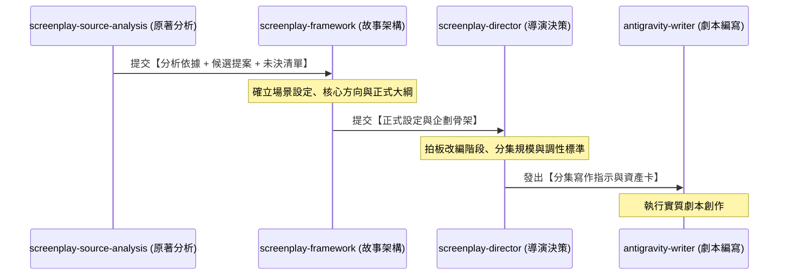

# 證據標註規範與下游交接協議 (evidence-and-handoff)

本文件詳述分析過程中之事實證據標註格式、抽樣快評規格、改編候選提案格式，以及向下游交付之標準協議。

## 1. 證據標註規範

為杜絕幻覺與推測腦補，所有分析報告必須實施精確證據引用。

### 1.1 引用格式標準
每條事實性結論、角色行為、重要世界觀規則與情感轉折旁，均須註明出處：
以下人物、情節與行號皆為格式示例，不代表任何實際原著。

```markdown
- 分析結論：林默在此處選擇隱瞞玉佩真相，刻意維持與陸遠的合作假象。
  - 來源依據：來源：第 12 章，原文第 138–151 行
  - 核心佐證詞句：「林默將玉佩按入袖底，抬頭笑道：『此物不過是街邊舊器。』」
```

### 1.2 最短必要引用原則 (Minimal Citation)
- 嚴禁整段或多行複製原文。
- 引文僅保留最關鍵、最核心之詞句或對白（建議 30 字以內），主要篇幅應用於提煉其劇情作用與資訊差。

### 1.3 未明確標記原則 (Explicit Undefined Rule)
- 若原文情節發展缺少明確動機、時間線模糊、或關鍵設定未交代，必須明確標記：`【原文未明確】`。
- 嚴禁自行發揮想像力填補邏輯空白；未明確之處應直接納入「未決問題（Open Questions）」清單，提請創作者決策。

---

## 2. 抽樣快評報告規範

長篇原著在未指定特定範圍時，應進行抽樣快評，以建立對所抽章節節奏、寫作風格與改編潛力之先期認知。腳本採均勻間隔選章；樣本不代表未讀章節。

### 2.1 抽樣報告強制要件
抽樣快評報告開頭必須包含元數據方塊，數據必須完全來自腳本統計，不得含糊帶過：
- **總章數**：腳本索引之全書總章數。
- **抽樣章數**：本次實際分析章數。
- **覆蓋百分比**：`(抽樣章數 / 總章數) * 100%`（四捨五入至小數點後一位）。
- **所抽章序清單**：具體列出章序（如：`[1, 15, 30, 45, 60, 75, 90]`）。

### 2.2 抽樣免責與邊界宣告
報告前言必須明載下列警語：
> **免責聲明**：本快評報告僅基於均勻間隔選出的樣本章節（覆蓋率 X.X%）撰寫，結論僅代表抽樣章節顯現之風格與情節特徵，不可冒充全讀結論，亦不代表全書完整邏輯閉環。未抽樣章節之劇情轉折與人物變化未納入考量。

### 2.3 抽樣報告結構模板
```markdown
# 原著抽樣快速評估報告

## 抽樣基本資訊
- 來源檔案：輸入/novel.txt
- 索引檔案：cache/novel_index.json
- 總章數：320 章
- 抽樣章數：10 章
- 覆蓋百分比：3.1%
- 抽樣章序：第 1, 35, 70, 105, 140, 175, 210, 245, 280, 315 章

## 樣本風格與核心吸引力提煉
（條列抽樣章節展現之節奏、人物語氣與核心衝突）

## 潛在改編風險與矛盾點
（記錄抽樣所見之邏輯斷裂或重複套路）

## 建議後續拆解範圍
- 建議優先拆解：第 1–30 章（建立初期核心世界觀與第一幕高潮）
- 待創作者決策事項：是否同意上述範圍？或指定其他 sequence？
```

---

## 3. 改編候選提案規格 (Candidates)

本階段所整理之一切改編架構均為**候選提案**，供創作者與導演裁決，嚴禁視為既定結論。

### 3.1 角色演進候選 (Character Evolution Candidate)
記錄核心人物之起點、轉折點與弧線走向：
- **角色姓名**：
- **原著定位**：
- **劇情作用演進**：（附來源章序與行號）
- **改編取捨候選建議**：（例如：合併邊緣配角 A 與 B，強化衝突）
- **創作者裁決狀態**：`待決策`

### 3.2 世界觀與設定規則候選 (World-building Candidate)
- **核心規則名稱**：
- **原文依據**：（附來源章序與行號）
- **原文未明確處**：
- **改編簡化／重塑候選方案**：
- **創作者裁決狀態**：`待決策`

### 3.3 劇情單元與爽點排序候選 (Plot Units & Climax Ranking)
依據戲劇張力排序核心高潮與爽點事件：
| 優先序 | 劇情單元名稱 | 核心事件與衝突 | 劇情作用（抉擇／資訊差／強弱逆轉） | 原文依據 | 改編可行性評估 |
| :--- | :--- | :--- | :--- | :--- | :--- |
| 1 | 退婚打臉 | 寧遠當眾揭露退婚真相 | 強弱逆轉、資訊差引爆 | 來源：第 3 章，原文第 40–85 行 | 適合第一幕高潮點 |
| 2 | 秘境奪寶 | 背叛同門奪取丹藥 | 道德抉擇、生死危機 | 來源：第 18 章，原文第 210–260 行 | 需強化反派壓迫感 |

### 3.4 製作形態適配與分集候選 (Format & Episode Breaks)
- **形態適配候選分析**：
  - 豎屏微短劇可前置衝突，從本案的集長、平台與可保留的戲劇結果評估壓縮空間。
  - 橫屏中長劇：側重人物關係厚度與世界觀逐步鋪展。

逐集記錄候選起訖章序及行號、觸發事件與主角選擇、可在本集兌現的結果、集尾斷點和可能的下一集第一動作。將這些分集取捨標為候選，交劇本框架核定。若來源範圍只支持當下行動，標明仍待揭露的事實及後續取證範圍。

- **必留內容**附來源章序及行號，標記是創作者已確認必留，或分析建議保留。已確認必留的事件、抉擇、因果和台詞隨交接保留其核准依據。
- **揭露進度**在候選分界記下角色與觀眾已知的資訊、首次得知的章節位置、尚未揭露的事項，以及下游可只提醒而無須重述的前情。

---

## 4. 下游交接協議

原著分析完成後，需依據本協議封裝成果並轉移上下文。

### 4.1 交付流程與權責邊界

- **禁止越權行為**：`screenplay-source-analysis` 絕不越權代替 `screenplay-framework` 撰寫正式人物資產卡或分場大綱；絕不越權代替 `screenplay-director` 決定正式分集定案。

### 4.2 下游交接包裹清單 (Handoff Bundle)
交付下游時，必須備齊下列項目：
1. **章節索引檔**：驗證通過之 `novel_index.json`。
2. **逐章提取檔案庫**：通過 coverage 檢核之 `ch-*-extract.md` 集合。
3. **全域改編候選彙總**記錄本輪起訖章序、跳過章序、各分集候選的證據、必留內容與揭露進度。
4. **未決問題清單 (Open Questions)**：原文交代不清或需創作者裁決之題目。
5. **獨立 QA 檢核紀錄**：標註待審／通過／退回狀態之進度紀錄。

### 4.3 未決問題與創作者決策清單範例
```markdown
# 改編前置未決問題清單 (Open Questions)

以下問題源自原著未明確之設定或戲劇化改編衝突，提請創作者裁決：

1. **【角色動機】**
   - 問題：原文第 8 章未明確交代陸遠為何突然背叛師門，情節顯得突兀。
   - 候選方案 A：改編為早已被敵對勢力以親人要挾。
   - 候選方案 B：改編為追求禁術走火入魔。
   - 創作者裁決：[待填寫]

2. **【分集斷點取捨】**
   - 問題：若採用微短劇形態，原著前 5 章情節偏慢，打臉點在第 6 章中段。
   - 候選方案：是否同意將第 6 章前置，開場即引爆退婚衝突？
   - 創作者裁決：[待填寫]
```

---
